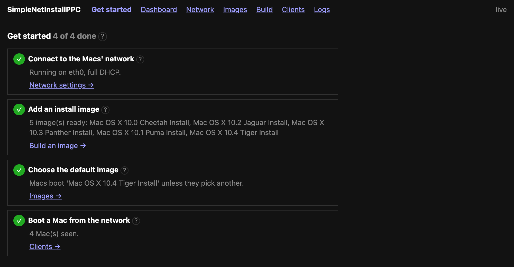
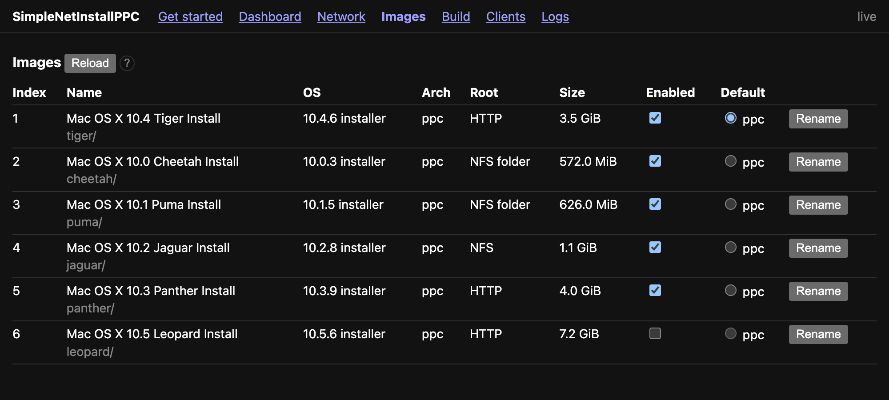
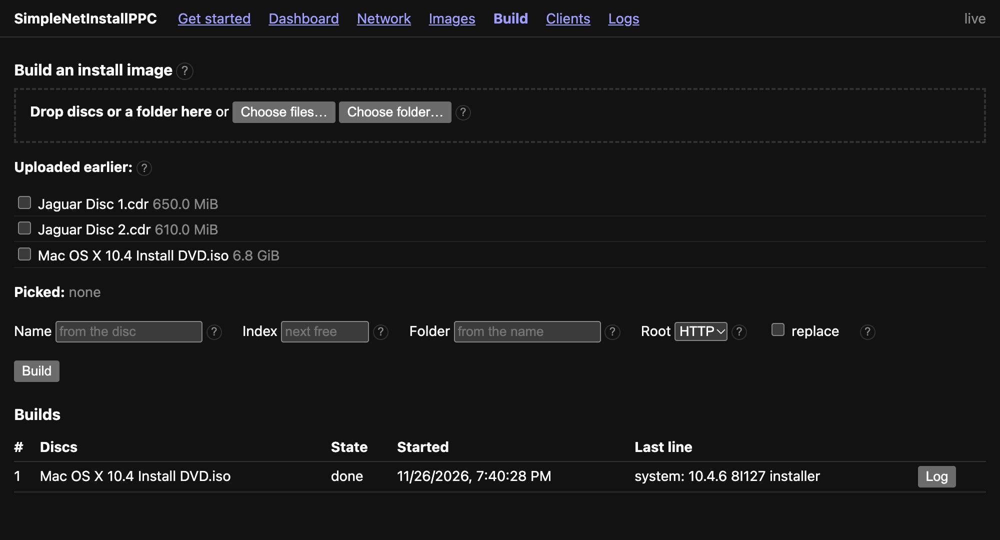
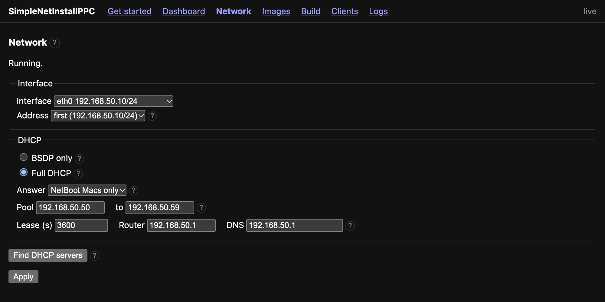

<p align="center"></p>

# SimpleNetInstallPPC

NetInstall for Mac OS X 10.0 – 10.5 (PowerPC and Intel), hosted on Linux
(Debian, Fedora) or macOS 14+. No more USB sticks or optical drives to
install old Macs.

**Status:** PowerPC NetInstall works from Linux and macOS for 10.0 – 10.5,
with a web UI and a service install. Intel Macs and Mac OS 9 come later. See
the [user guide](docs/GUIDE.md) to set it up.

## Screenshots

The web UI, shown with sample data (`docs/screenshots/demo.py` makes these).
It opens on **Get started**, which ticks off each step of the setup:

<p align="center"></p>

| | |
|---|---|
|  |  |
| **Dashboard:** a light per service, and the settings in use | **Images:** enable them, rename them, pick the default |
|  |  |
| **Build:** drop the install discs, then build | **Network:** the interface, and DHCP next to your router |
|  |  |
| **Clients:** each Mac and the image it boots | **Logs:** live, with a filter |

## What works now

- **DHCP/BSDP server.** BSDP-only mode next to an existing DHCP server, or
  full DHCP with an address pool. Per-architecture default image, model
  filters, and the NetBoot 1.0 firmware fallback.
- **TFTP server.** Read-only and path-jailed, with blksize/tsize/timeout options.
- **HTTP server** for root images, with byte ranges, keep-alive and `sendfile`.
- **Mac OS X 10.0 / 10.1:** BOOTP, bootparamd and folder roots are set up
  automatically: auto-mount, a managed `/etc/exports` block on macOS, and a
  built-in read-only NFS v2 server on Linux. The image maker builds an mkext
  when the media lacks one.
- **Image maker.** Compressed `.dmg` files are read directly, on Linux too.
  `make-test-image` turns a `.dmg`/`.img`/`.iso`/`.cdr` of
  an install CD/DVD into a NetInstall image folder. It handles APM, GPT,
  MBR, bare volumes and HFS wrappers. Given all the discs of a multi-CD set,
  it merges them into one image, so the installer never asks for another
  disc.
- **Startup Disk:** each Mac's last selected image is remembered and offered
  as its selected image, as Apple's server does.

## Run it

It's one file with its own DHCP/BSDP, TFTP, HTTP and NFS servers. Only
Python 3.9+ is needed, so it runs on any Linux or Mac without installing
anything:

```bash
python3 packaging/build_pyz.py
```

```bash
sudo ./dist/simplenetinstallppc.pyz serve
```

Copy `simplenetinstallppc.pyz` anywhere and run it there; Ctrl-C stops it.
The images and settings go in a `simplenetinstallppc-data` folder next to it,
so one USB stick carries everything.
`./simplenetinstallppc.pyz check` lists anything the host is missing. The web
UI opens in your browser when you start it on a desktop; it's at
http://127.0.0.1:8080/ on the server (from another computer:
`ssh -N -L 8080:127.0.0.1:8080 <server>`). It has no password, since only the
server itself can connect. The UI opens on a Get started guide: choose the network,
build an image from your install discs, pick the default, then hold **N** on
the Mac. The [user guide](docs/GUIDE.md) covers each step, booting the Macs
and troubleshooting.

Optional: `sudo ./packaging/install.sh` puts the `simplenetinstallppc` command
in `/usr/local/bin`, and `--service` adds a service that starts it at boot.
From the source folder without building: `sudo PYTHONPATH=src python3 -m
simplenetinstallppc serve`.

## Tests

```bash
PYTHONPATH=src:tests python3 -m unittest discover -s tests
```

## Layout

```
src/simplenetinstallppc/
  cli.py              command-line entry point
  checks.py           `check`: what the host is missing, and how to fix it
  server.py           starts DHCP/BSDP + TFTP + HTTP together
  catalog.py          image folders and NBImageInfo.plist
  events.py           logging + event bus (feeds the web UI)
  store.py            SQLite state: clients, saved images, leases, settings
  netsettings.py      interface + DHCP settings (UI, command line, saved)
  web/                web UI: app.py (HTTP + JSON API), jobs.py (builds), static/ (page)
  netif.py            interface discovery and binding (Linux/macOS)
  net/                dhcp_packet, bsdp, dhcp_server, leases, tftp, http_server
  imaging/            partitions (APM/GPT/MBR/HFS wrapper), quick_image, mkext, merge (multi-CD)
packaging/            build_pyz.py (the single file), install.sh, systemd unit, launchd plist
docs/screenshots/     demo.py (the web UI with sample data) and the README screenshots
tests/                unit tests (stdlib unittest)
docs/GUIDE.md         user guide
```
