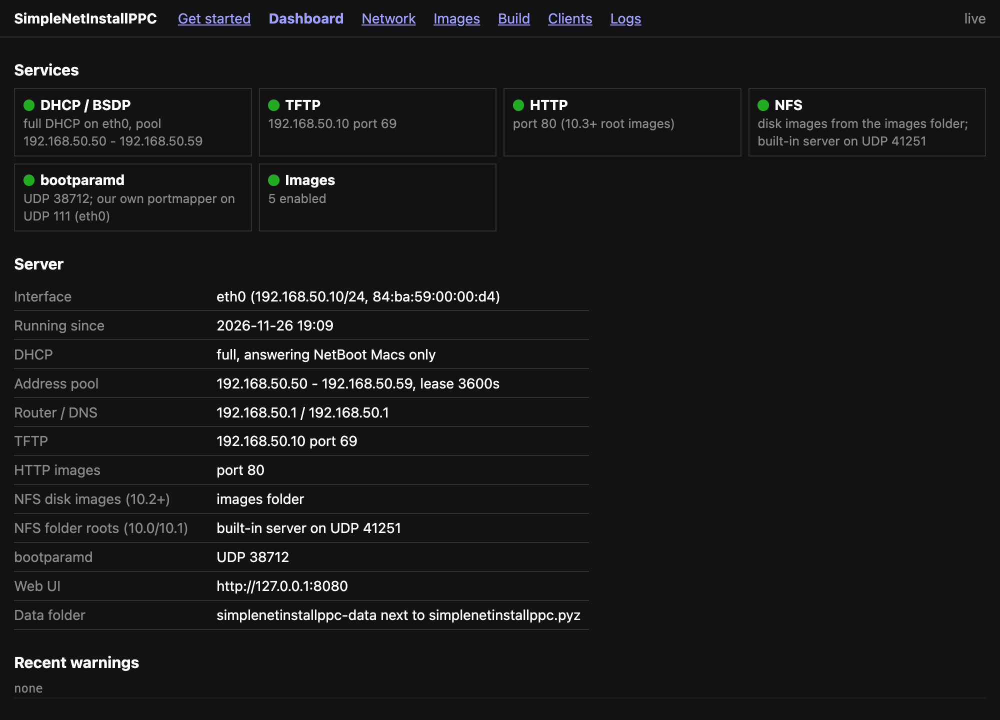
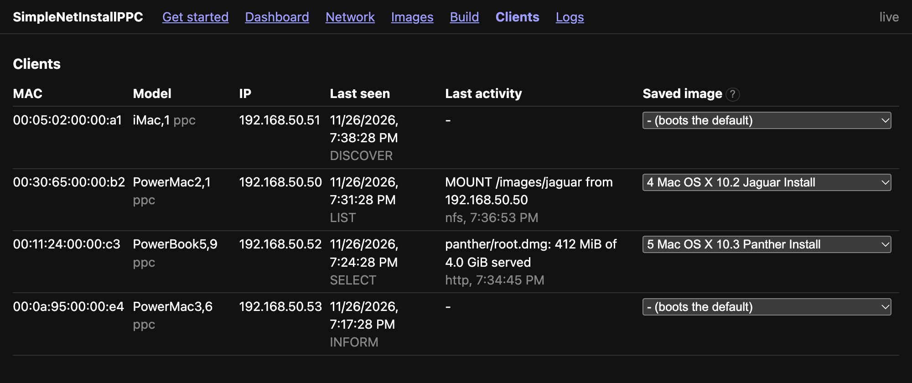
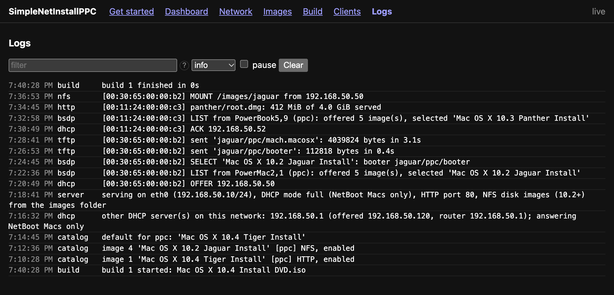

<p align="center"></p>

# SimpleNetInstallPPC

A NetBoot server for installing Mac OS X 10.0 to 10.5 on PowerPC Macs over
Ethernet. You give it images of the install CDs or DVDs, and a Mac started
with the N key (or the Option key, or Startup Disk) boots the installer from
the network. The server runs on Linux or macOS.

Apple's own way to do this was the NetBoot service in Mac OS X Server. This
project does the same job without it. It's written in Python, uses only the
standard library, and can be built into a single file.

## Status

It works for the Macs and versions below. Everything else is untested.

Tested on real hardware (the installer started on the Mac):

| Mac OS X | Root over | From a macOS host | From a Linux host (Fedora) |
|---|---|---|---|
| 10.0 Cheetah | NFS folder | iMac G3 (tray and slot-loading) | iMac G3 (tray and slot-loading) |
| 10.1 Puma | NFS folder | iMac G3 (tray and slot-loading) | not tested |
| 10.2 Jaguar | NFS disk image | iMac G3 (tray and slot-loading) | iMac G3 (slot-loading) |
| 10.3 Panther | HTTP | iMac G3 (tray and slot-loading) | iMac G3 (tray-loading) |
| 10.4 Tiger | HTTP | iMac G3 (tray and slot-loading) | iMac G3 (tray-loading), Power Mac G4 |
| 10.5 Leopard | HTTP | PowerBook G4 | not tested |

Known problems and gaps:

- 10.0 hangs during boot on a Power Mac G4. The cause isn't known yet.
- Multi-CD sets: discs are merged into one image so the installer doesn't ask
  for disc 2. This was checked for Jaguar's two CDs, where the merged image
  matches one merged by hand that installed fine. The Panther and Tiger CD
  sets haven't been tried, and neither has the installer's disc prompt.
- Intel Macs aren't supported. Some code for them exists, but none of it has
  been tested.
- Mac OS 9 NetBoot is planned but not started.
- Only New World Macs can NetBoot: iMac G3 and later, Blue & White G3, G4,
  G5, iBook, PowerBook G3 (Lombard, Pismo) and later. Older Macs can't.
- Linux hosts: only Fedora has been tested. Debian and others should work,
  since nothing distribution-specific is used beyond the `hfsplus` kernel
  module.
- macOS hosts: tested on macOS 14.
- The optional systemd and launchd services are written but haven't been
  tried on a real host.
- Disk images: raw images, ISO, `.cdr`, `.toast` and `.dmg` (UDIF, including
  compressed ones) are read. Disk Copy 4.2 and NDIF `.img` files are not.

## Running it

Build the single file, then run it as root (it needs ports 67, 69, 80 and
111, and mounts disk images):

```bash
python3 packaging/build_pyz.py
```

```bash
sudo ./dist/simplenetinstallppc.pyz serve
```

It runs until Ctrl-C. Images and settings are kept in a
`simplenetinstallppc-data` folder next to the file, so the file can be copied
anywhere, for example to a USB stick, along with its data. Only Python 3.9 or
later is needed.

The web UI is at http://127.0.0.1:8080/ and only accepts connections from the
machine itself, so it has no password. From another computer, use an SSH
tunnel: `ssh -N -L 8080:127.0.0.1:8080 <server>`. When started from a terminal
on the server's desktop, it opens in the browser by itself.

`./simplenetinstallppc.pyz check` lists what the host is missing (for example
the `hfsplus` module, or closed firewall ports). The [user guide](docs/GUIDE.md)
covers setup, building images, booting the Macs and troubleshooting.

To run from the source folder instead:
`sudo PYTHONPATH=src python3 -m simplenetinstallppc serve`.

## How it works

A Mac's firmware NetBoots in a fixed sequence, and the server answers each
step:

1. **DHCP and BSDP.** The Mac broadcasts a DHCP request carrying BSDP, Apple's
   extension for listing and choosing boot images. The server replies with the
   images it has and the one this Mac should boot. It can hand out addresses
   itself, or only answer the BSDP part and leave addresses to an existing
   router. When it does hand out addresses, it only answers Macs that are
   NetBooting.
2. **TFTP.** The firmware downloads the booter, then the kernel and its
   driver cache (mkext).
3. **Root file system.** The kernel mounts the install volume:
   - 10.3 to 10.5: a disk image over HTTP;
   - 10.2: a disk image over NFS;
   - 10.0 and 10.1: these kernels can't boot from a disk image. They do an
     older diskless boot: BOOTP, then bootparamd to find the root, then an NFS
     v2 *folder*. The server mounts the image's volume and exports that folder.
4. The installer starts from the mounted volume.

All of it runs in one Python process (asyncio for the network services,
threads for the web UI):

```
                            simplenetinstallppc serve
 ┌──────────────────────────────────────────────────────────────────────────┐
 │  web UI + JSON API         http.server, plain JavaScript, live log (SSE) │
 ├────────────┬──────────┬──────────┬────────────────────────┬──────────────┤
 │ DHCP/BSDP  │  TFTP    │  HTTP    │ NFS v2, portmapper,    │ image builds │
 │            │          │ (Range)  │ bootparamd (10.0-10.2) │ (subprocess) │
 ├────────────┴──────────┴──────────┴────────────────────────┴──────────────┤
 │  catalog: image folders     store: SQLite         event log              │
 │  (NBImageInfo.plist)        (settings, Macs,      (feeds the UI and      │
 │                              leases)               the terminal)         │
 └──────────────────────────────────────────────────────────────────────────┘
   host tools: Linux mount -t hfsplus / ip;  macOS hdiutil, diskutil, nfsd
```

The parts, under `src/simplenetinstallppc/`:

- `net/dhcp_server.py`, `net/bsdp.py`, `net/dhcp_packet.py`: DHCP and BSDP,
  plus plain BOOTP, which the 10.0 and 10.1 kernels use. `net/dhcp_probe.py`
  looks for other DHCP servers on the network before starting, so it doesn't
  clash with the router's pool.
- `net/tftp.py`: read-only TFTP limited to the images folder.
- `net/http_server.py`: serves root images with byte ranges.
- `net/nfs2.py`, `net/rpc.py`, `net/portmap.py`, `net/bootparamd.py`: a
  read-only NFS v2 server, a portmapper and bootparamd. Linux's own NFS server
  can't export HFS+ volumes and often lacks NFS v2, so these are built in. On
  macOS the system's `nfsd` is used for 10.0/10.1 instead.
- `roots.py`: mounts the volumes that 10.0/10.1 boot from.
- `imaging/`: turns install discs into images. `udif.py` reads `.dmg` files
  without `hdiutil`. `partitions.py` finds the HFS+ volume in a disc image (in
  an Apple, GPT or MBR partition map, or inside an HFS wrapper).
  `quick_image.py` copies the volume into `root.dmg` and pulls out the booter
  and kernel. `mkext.py` builds the driver cache when a disc lacks one (10.0).
  `merge.py` merges multi-CD sets.
- `catalog.py`: each image is a folder with Apple's `NBImageInfo.plist`, as on
  Mac OS X Server.
- `store.py`: SQLite for settings, the Macs seen, the image each one chose and
  DHCP leases. `events.py`: the event log the UI and terminal show.
- `web/`: the web UI. `app.py` is the HTTP server and JSON API, `jobs.py` runs
  builds, `files.py` takes uploads, `static/` is the page.
- `cli.py`, `server.py`: the commands, and starting and stopping the services.
  `checks.py` is `check`. `desktop.py` opens the browser.

Other folders: `packaging/` has `build_pyz.py` (the single file),
`install.sh` and the service files. `docs/` has the user guide and screenshots
(`docs/screenshots/demo.py` produces them). `tests/` holds the tests.

There are no dependencies outside Python's standard library. The server runs
as root, and installing packages into root's Python on every host would be a
burden, so everything is built with the standard library: DHCP, TFTP, HTTP,
NFS and the disk image formats.

## Screenshots

The web UI with sample data.

<p align="center"></p>

| | |
|---|---|
|  |  |
| Dashboard: the state of each service | Images: enable, rename, choose the default |
|  |  |
| Build: upload discs and build an image | Network: interface and DHCP settings |
|  |  |
| Clients: the Macs seen and their chosen image | Logs |

## Tests

```bash
PYTHONPATH=src:tests python3 -m unittest discover -s tests
```

The tests are standard-library unittest. They include replays of real DHCP,
BSDP, TFTP and bootparam traffic captured from iMac G3s, and small `.dmg`
files made with `hdiutil`. The tests that start the whole server are skipped
unless run as root. None of this replaces trying it on a real Mac.
